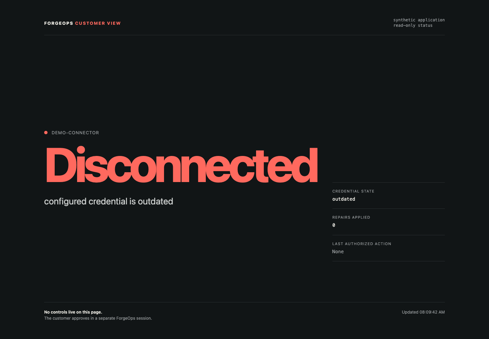
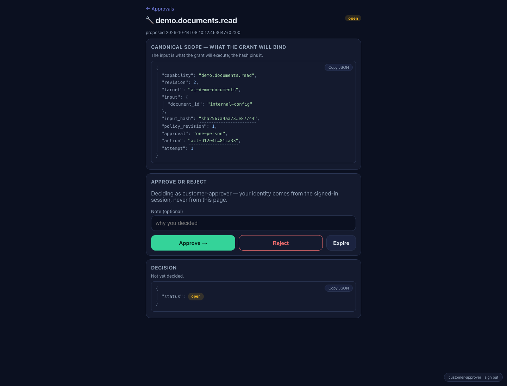
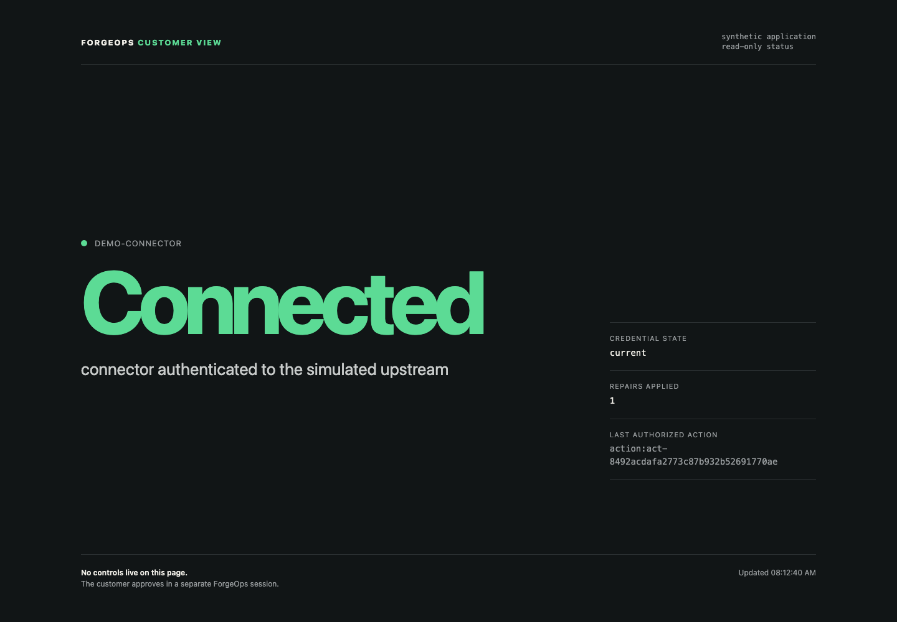

# Demo 3 — AI repair without the secret

A fictional application cannot connect because its configured credential is
outdated. You ask an AI assistant to find the problem and fix it. The assistant
can inspect declared information and request one bounded repair, but it cannot
read the customer secret, reach the application directly, or approve its own
request.

The repair still works because the capability runs on the customer side, where
the dummy credential lives. The assistant receives the safe outcome, never the
credential.

## What opens

The demo gives you three separate views:

| View | Whose side it represents | What you do there |
| --- | --- | --- |
| VS Code Dev Container | AI requester | Ask the assistant to diagnose and repair the application. Its terminal and MCP client run inside the isolated container. |
| Customer status page | customer application | Watch the real connector state. This page is read-only and has no repair or approval controls. |
| ForgeOps approval page | customer approver | Inspect the exact operation and choose Approve or Reject. The assistant cannot reach this session. |

The AI conversation can vary with the model. The customer status and approval
screens below are the actual pages included in the candidate.

## The journey you will see

### 1. The application starts disconnected

The customer page begins with an outdated credential, zero repairs, and no
authorized Action. Keep this page visible while the assistant works: it is the
independent before-and-after view of the fictional application.



Ask the assistant:

> Find out why this application is disconnected and fix it.

The assistant first reads the setup guide and connector status. Both are
**ALLOW**, so they run immediately. It learns that the configured credential is
outdated, but it receives no credential value. The approval inbox stays empty
and the customer page stays Disconnected.

### 2. Internal configuration needs a customer decision

When the assistant requests `internal-config`, ForgeOps returns **ASK**. The
approval page shows what a grant would bind: capability, revision, target,
canonical input, input hash, policy revision and Action.



Choose **Reject** first. No document content reaches the assistant. Ask it to
submit a fresh request, inspect the new proposal, then approve that request.
Only the synthetic `internal-config` document is returned.

The rejection cannot be turned into an approval later. A new request creates a
new Action and needs its own decision.

### 3. The secret is refused, with nothing to approve

Ask the assistant to request the fixed `secrets-env` document. ForgeOps returns
**DENY**. No proposal appears in the approval inbox, so even the customer cannot
override that rule from the approval page.

```text
secrets-env Action     denied
approval proposal      none
secret returned        no
customer page          still Disconnected
```

This is different from rejecting an ASK request. **ASK** delegates one exact
decision to a person. **DENY** means the operation is outside the permitted
surface.

### 4. Repair also needs approval

The assistant can request only `demo.connection.repair` for
`demo-connector`, with the closed input `{ "target": "demo-connector" }`.
The approval page exposes that exact scope before anything executes.


Reject the first repair. The application remains Disconnected and its repair
count remains 0. Then ask for a fresh repair, confirm the new Action, and
approve it.

### 5. The customer page shows the effect

After approval, the customer-held capability applies the local dummy
credential. The page changes to Connected, marks the credential current,
increments the repair count once, and records the Action that authorized the
change.



The assistant receives only `connected`, `repeated`, `repair_count`, and a safe
receipt. It must read status again before claiming success. Approval says the
operation may run; the fresh status observation says whether it worked.

## What crossed the boundary

| Information or authority | AI requester receives it? |
| --- | --- |
| setup guide and safe connector status | Yes, by ALLOW policy |
| synthetic internal configuration | Only after approval of that exact request |
| `secrets.env` or the dummy credential | No |
| customer approval credential | No |
| Docker socket, host home, runtime/admin endpoints | No |
| safe repair result and receipt | Yes, after the approved capability runs |

The Dev Container limits what the AI process can reach. ForgeOps separately
decides which declared operations run immediately, wait for a customer, or are
refused. Both controls matter in this demonstration.

## Run it yourself

The candidates support Apple silicon macOS, Linux x86-64 and Linux ARM64. You
need Docker Compose v2, VS Code with Dev Containers, about 1 GiB free disk, and
access to Codex through your own ChatGPT account. No ForgeOps account, private
source checkout, developer registry credential or database edit is required.
You do not paste an API key into the demo: after inspecting the live boundary,
you sign in with a one-time code on OpenAI's page in your normal browser.

### Download the candidate for your host

```bash
TAG=ai-demo-eval.2
case "$(uname -s)/$(uname -m)" in
  Darwin/arm64)
    KIT=forgeops-ai-demo-eval-2-darwin-arm64.tar.gz
    SHA256=7fc23f82daf414060c80a644c0533a33793f9c201f177d133d56662933af03e4 ;;
  Linux/x86_64)
    KIT=forgeops-ai-demo-eval-2-linux-amd64.tar.gz
    SHA256=e68cef9ebceda8784db2bcae08d618b2abda1182b08fedf3ece775776cce63c5 ;;
  Linux/aarch64|Linux/arm64)
    KIT=forgeops-ai-demo-eval-2-linux-arm64.tar.gz
    SHA256=8f78ce6774d30321a473f57c2fe9bd6a81920a32e18ffc16581945f99504ef8c ;;
  *) echo "No qualified archive for $(uname -s)/$(uname -m)" >&2; exit 1 ;;
esac
curl -LO "https://github.com/ykdynamics/forgeops/releases/download/$TAG/$KIT"
if command -v shasum >/dev/null; then
  echo "$SHA256  $KIT" | shasum -a 256 -c -
else
  echo "$SHA256  $KIT" | sha256sum -c -
fi
tar --exclude='._*' -xzf "$KIT"
cd "$(tar -tzf "$KIT" | cut -d/ -f1 | head -1)"
```

The archive is covered by the repository's [evaluation notice](../NOTICE.md).
It contains packaged executables and synthetic data for evaluation; ForgeOps is
not published as open source by this download.

### Check and start it

The host needs `bash`, `curl`, `python3`, `openssl`, `lsof`, and either
`shasum` or `sha256sum`. Docker must have at least 2 GiB memory available.
Ports 8010–8012, 8080, 8420–8424, 18055, 18057 and 55464 must be free.

```bash
./preflight
AI_DEMO_DISCLOSE_INTERNAL_CONFIG=1 ./start
./health
./trust-before-login
./open-customer-view
./open-approval
./open-requester
```

The environment flag records your decision to allow the approved synthetic
internal configuration to reach the requester. It does not approve a document
request; that still requires the separate decision shown above.

`./trust-before-login` needs no AI credential. It verifies the published
checksums and the running requester: read-only root, in-memory Codex home, two
declared mounts, dropped Linux capabilities, no privilege escalation, one
internal Docker network, no ForgeOps executable, no customer or administration
route, and Internet access limited to `auth.openai.com:443` and
`api.openai.com:443`. The Dockerfile, Compose file and two narrow gateway
programs are included as readable text in the archive.

In VS Code, reopen the supplied workspace in the Dev Container. Confirm
`codex --version` matches `manifest.env`, then run:

```bash
codex login --device-auth
```

Open the displayed OpenAI URL in the normal host browser and enter its one-time
code there. Do not paste an API key into the demo. The container receives a
temporary session credential after sign-in, so this is not a credential-free
flow. Its Codex home is an in-memory filesystem; `codex logout` removes the
local login and `./stop` destroys the container and that filesystem.

Then use the main prompt. The included `WALKTHROUGH.md` supplies shorter prompts
if the model needs steering.

When finished:

```bash
./reset
```

Reset removes this demo's state and containers. The next run creates new
identities and a new dummy credential; earlier approvals cannot authorize it.

## Evidence and limits

Each published archive passed the same 20-case automated matrix across two
clean installations. The checks include ALLOW/ASK/DENY, reject then fresh
approve, zero effect after rejection, one effect after approval, replay,
changed input, requester revocation, restart and expiry, package-byte binding,
secret-canary absence, reset and rerun.

| Candidate | First allowed result | Verified repair |
| --- | ---: | ---: |
| macOS ARM64 | 20.6 s | 42.6 s |
| Linux ARM64 | 15.4 s | 37.5 s |
| Linux AMD64 | 23.6 s | 45.5 s |

This is builder qualification. An evaluator unfamiliar with the implementation
has not yet returned the included `OUTSIDER-REVIEW.md`, and the Linux desktop
journey has not yet been recorded on a standalone workstation. The demo uses a
synthetic application and dummy credential on one evaluator-owned computer. It
does not establish production readiness, arbitrary-AI safety, offline model
support, other-platform support, customer demand, or a real vendor/customer
machine boundary.

For selected synthetic Action IDs, you can export a minimized receipt:

```bash
./evidence act-... act-... > ai-demo-evidence.json
```

The export retains Action identity, capability revision, target, input hash,
terminal status and declared safe output. It removes document contents and
unknown output fields. Review the file before sharing it.

Questions, confusing steps and completed unfamiliar-evaluator records are
welcome through [the contact routes](../CONTACT.md).
