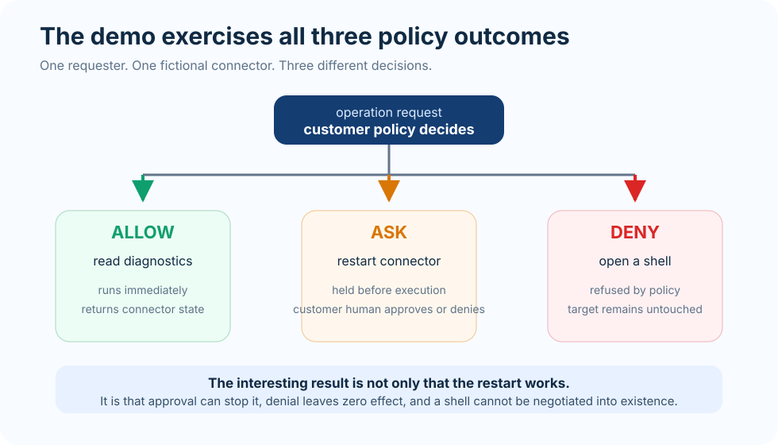
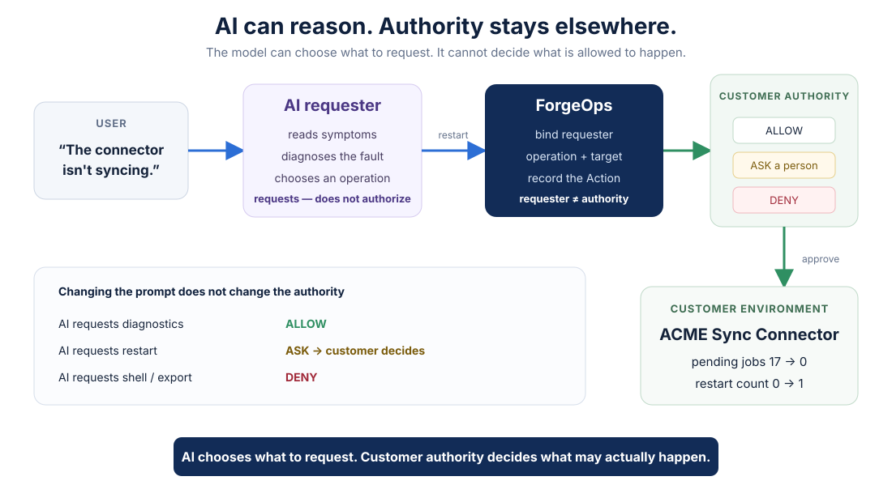
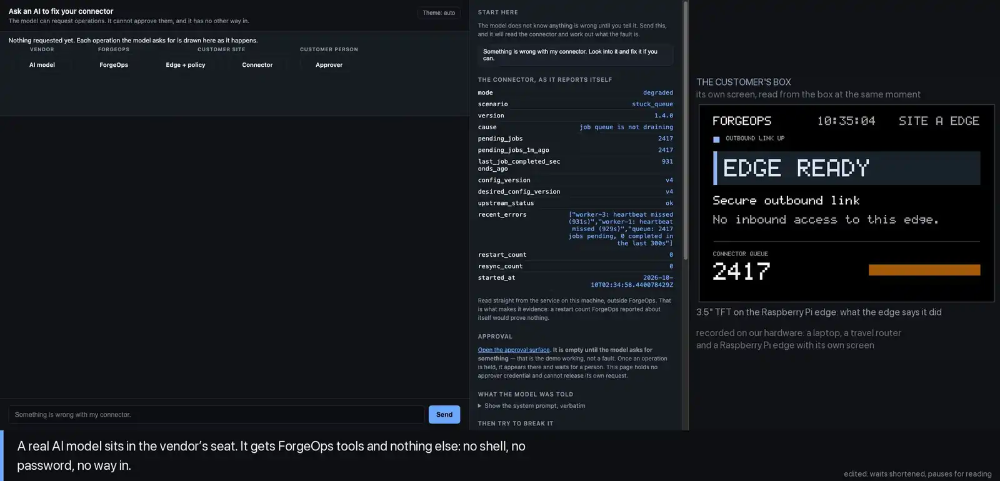
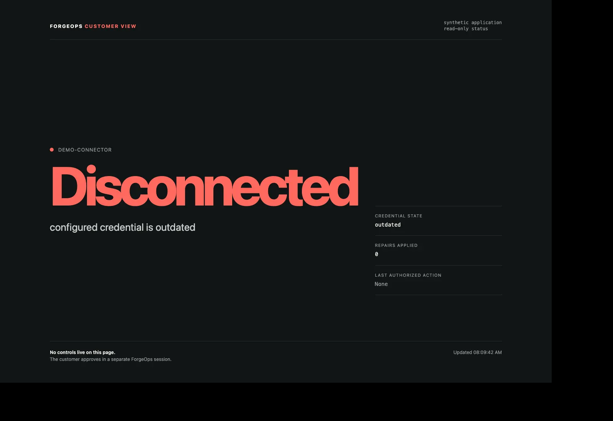
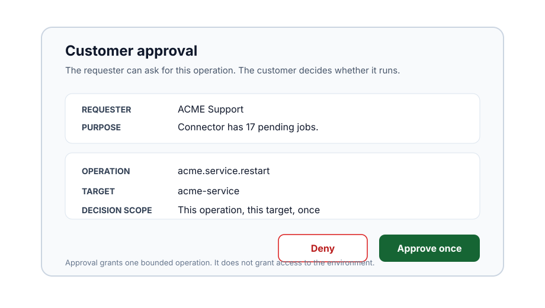

# ForgeOps demos

Three local demonstrations show the authority model from different angles.

Start with **Demo 1**: it shows the whole idea, with you as the customer's
approver. **Demo 2** is the follow-on: the same customer side, with a real model
in the vendor's seat. **Demo 3** is a separate, deeper candidate: the AI runs
inside an isolated requester and repairs a fictional application without
receiving its customer-local credential.

| | **Demo 1 — Core authority** | **Demo 2 — AI + MCP** | **Demo 3 — AI repair** |
|---|---|---|---|
| Purpose | Understand ForgeOps itself | See what changes when the requester is AI | Test document disclosure, secret refusal and customer-held repair |
| Requester | fixed first-touch scenario | real model using MCP tools | real model in an isolated Dev Container |
| Flow | diagnostics `ALLOW` → restart `ASK` → shell `DENY` | diagnose → reason → request → approval/refusal → verify | safe reads `ALLOW` → internal config `ASK` → secret `DENY` → repair `ASK` |
| Customer authority | policy + separate approval | the same policy + separate approval | policy, separate approval and customer-local dummy credential |
| Runs | locally | locally; model context goes to the configured model endpoint | locally on Apple silicon macOS or Linux; model context goes to the configured model endpoint |
| Account | none | no ForgeOps account | no ForgeOps account; own ChatGPT access, using browser/device sign-in after the boundary check |
| Start | `./try-forgeops` | `./try-with-ai` | `AI_DEMO_DISCLOSE_INTERNAL_CONFIG=1 ./start` |
| Walkthrough | **[Run Demo 1 →](BASIC.md)** | **[Run Demo 2 →](AI.md)** | **[Run Demo 3 →](AI-REPAIR.md)** |

## Demo 1 — Core authority

**See ALLOW, ASK and DENY produce real outcomes against a fictional connector on
your machine.**

```bash
./try-forgeops
```

Diagnostics run immediately. Restart reaches the customer side and stops until a
separate approver decides. Shell access is refused with zero target effect.



**[Download and run Demo 1 →](BASIC.md)**

## Demo 2 — AI + MCP

**Put a real model in the requester seat without giving it customer authority.**

```bash
./try-with-ai
```

The model reads symptoms, chooses whether restart, resync, waiting or no action
makes sense, and requests bounded operations through `forge-mcp`. A consequential
operation still stops at `ASK`; the model cannot approve itself or widen policy.



Recorded on our own hardware (a laptop and a Raspberry Pi whose 3.5" screen
says what the customer's side decided), edited for pace. The download runs the
same thing with every side on your laptop:



**[Run the AI + MCP walkthrough →](AI.md)**

## Demo 3 — AI repair without the secret

**Let an AI repair a fictional application while the customer keeps the only
credential that can perform the repair.**

This separate evaluation candidate adds a VS Code Dev Container for the
requester, explicit document disclosure, a fixed secret request that policy
refuses, and a customer status page that provides visible before-and-after
evidence. Reject the first bounded repair and nothing changes. Approve a fresh
request and the application connects; the assistant receives only the declared
safe result.

The walkthrough uses the real customer and approval pages to show the initial
Disconnected state, the exact bounded proposal, the no-effect rejection, and
the final Connected state:



The candidates support Apple silicon macOS, Linux x86-64 and Linux ARM64 and
have passed the full builder qualification. An evaluator unfamiliar with the
implementation has not yet completed the walkthrough, and the Linux desktop
journey has not yet been run on a standalone workstation, so those limitations
travel with the downloads.

**[See the screens and run the AI repair candidate →](AI-REPAIR.md)**

## What will open in your browser

All three demos use the real ForgeOps Approval PWA when an Action needs a
customer decision. The exact requester, purpose, operation and target are shown
before anything is released.



The image above is a schematic for Demo 1 and Demo 2. Those demos open the
actual PWA locally, and their recordings on the [front page](../README.md) and
in [Demo 2](AI.md) show the real page. [Demo 3](AI-REPAIR.md) includes current
screenshots from its own customer and approval pages.

Demo 2 also opens a local chat page with the connector's live state beside the
conversation so you can compare what the model says with what the target itself
reports.

## Before you start

Demo 1 and Demo 2 use the same first-touch bundle.

```text
Docker           running
curl, python3, lsof, bash
ports free       8010-8012, 8080, 8089, 8093-8095, 18054-18057, 55454
                 plus 8099 if you bring your own operation
about 1 GB       bundle + Postgres image on first run
```

For Linux-specific setup, see [LINUX.md](LINUX.md).

Want the diagrams before running anything? Start with the
[visual walkthrough](VISUAL-GUIDE.md).

## Which one should I choose?

Start with **Demo 1** if you have not seen ForgeOps before. It establishes the
core claim without involving model behaviour.

Run **Demo 2** next if you want to see the same authority model with a requester
that can inspect symptoms, reason and choose tools dynamically.

Run **Demo 3** if you want to inspect the AI process boundary and see a
customer-held credential used by a narrowly approved capability without being
returned to the requester.

The demos are deliberately separate because AI is a requester type, not a second
execution path and not the definition of ForgeOps. Demo 3 also has a separate
bundle because its supported host, isolation boundary and qualification matrix
are different.
